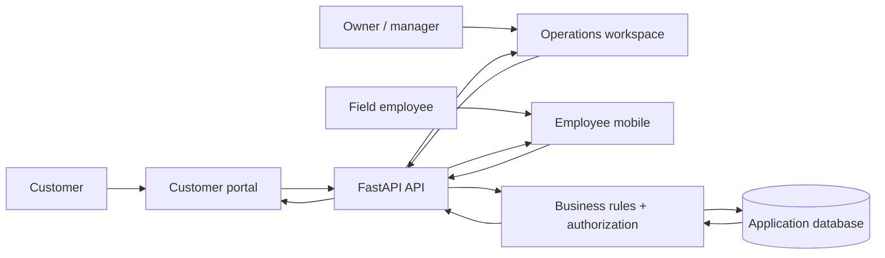

# CleanFlow — Product Walkthrough

CleanFlow is a full-stack commercial cleaning operations platform for running the customer journey and the operations journey in one connected product.

A customer can discover services, request a quote, review quotes, manage contracts, see upcoming service, review invoices and follow their service history. The operations team can manage leads, customers, properties, services and pricing, quotes, contracts, schedules, jobs, employees, invoices, feedback, analytics, audit history, notifications, team accounts, settings and integrations. Field employees get a focused mobile experience for the work assigned to them.

This walkthrough is for someone looking at the product and trying to understand the complete experience from the outside in.

## The product at a glance

**Customer request → lead → quote → contract → recurring schedule → job → field execution → invoice → payment → customer history**

The product is connected end to end:

**User action → React/Vite interface → FastAPI API → business rules + authorization → database → API response → updated interface**

The 16 screens below are real captures of the CleanFlow frontend with live seeded application data. The remaining feature areas are represented directly in the walkthrough and feature map rather than shown with invented screenshots.

## How the product works

## Public customer experience

### Home

The public website introduces the cleaning business and gives a visitor a direct path into the service journey.

### Request a quote

The quote form turns a visitor into a real business opportunity by collecting the property and service information needed for follow-up.

### Services

The public site explains the available service offering.

### Commercial and residential cleaning

The public experience separates the major service stories instead of forcing every visitor through the same generic page.

### Pricing and service areas

Visitors can understand pricing information and where the company operates before making a request.

### Trust and information

The remaining public pages cover company information, social proof, visual examples, common questions and direct contact.

## Sign in and choose the right workspace

CleanFlow separates the experience by role. Owners and managers work in the operations workspace, employees get the field-mobile experience and customers get the portal.

## Owner and operations workspace

### Dashboard

The dashboard gives the business a single operating picture: revenue, active contracts, upcoming work, completed jobs, invoices, leads and conversion signals.

### Leads

Leads organize incoming opportunities and their progress toward becoming customers.

### Quotes

Quotes turn customer requirements into a structured commercial proposal with connected pricing and customer data.

### Contracts

Contracts carry the relationship beyond the sale and connect the customer agreement to recurring service.

### Calendar

The calendar gives the operations team a visual view of scheduled service.

### Jobs

Jobs are the operational work units that connect customers, properties, schedules and employees.

### Customers and properties

Customer records keep the relationship, properties and service history together.

### Employees

Employee management connects the workforce to the work that has to be completed in the field.

### Invoices

Invoices turn completed service into a customer-facing financial record.

### Analytics

Analytics brings business and operational performance into one view.

### Feedback

Customer feedback feeds the service-quality side of the operations workflow.

### Audit and team accounts

Audit history records important activity, while team accounts let the owner control who can access the operational workspace.

### Settings and controls

Settings provide the operational configuration surface, including feature controls used to manage how the platform behaves.

## Record details and the handoff between workflows

The list pages are not isolated screens. Each record can be opened and worked through its own lifecycle.

This is where the same customer and operational data gets progressively richer: a lead can become a quote, a quote can become a contract, a contract produces scheduled work and jobs, and completed work feeds billing and history.

## Customer portal

### Customer home and quotes

The customer sees a focused version of the relationship without entering the internal operations workspace.

### Customer contracts, schedule, history and invoices

The portal continues the relationship after the sale: agreements, upcoming service, history and financial documents remain visible in one place.

## Field operations

### Employee mobile

The field employee gets a mobile-sized workflow centered on today's assigned work.

### Employee job detail

The job detail screen is where the field workflow becomes actionable. The wider system supports checklist completion, proof photos/uploads, notes, check-in/out and job completion gating.

## Billing, payments, notifications and integrations

Once service is delivered, CleanFlow keeps the rest of the relationship connected:

**Job completed → customer feedback → invoice → payment → customer history**

Behind those screens are shared platform capabilities for notifications, audit history, role-based access, feature flags, uploads, webhooks, search, configuration and reporting. They are not separate products; they support the same end-to-end workflow shown above.

## A real persistence story

A customer request can enter through the public experience, become a lead for the operations team, move into quoting and contract management, create scheduled work, produce jobs for employees and eventually appear in billing and the customer's history.

The same principle is used throughout the product:

**Create or change something in the interface → the backend processes it → the application stores it → another screen reads the updated record back**

## Feature map

| Area | What it is for |
|---|---|
| Public website | Service discovery, pricing, service areas, trust, FAQ and contact |
| Quote requests | Turn customer interest into business opportunities |
| Authentication & roles | Separate owner, manager, employee and customer experiences |
| Dashboard | Operational overview |
| Leads | Track and progress new opportunities |
| Customers & properties | Manage customer relationships and service locations |
| Services & pricing | Reusable service definitions, rates and quote inputs |
| Quotes | Customer-facing commercial proposals |
| Contracts | Ongoing service agreements |
| Scheduling & calendar | Recurring and future service planning |
| Jobs | Operational service work |
| Employee mobile | Field execution experience |
| Checklists, notes & proof uploads | Capture completion evidence in the field |
| Invoices & payments | Billing and money received |
| Feedback | Customer service experience |
| Analytics & reports | Business and operational visibility |
| Audit log | Activity history |
| Notifications | Important activity and status communication |
| Team accounts | Owner/manager access administration |
| Customer portal | Quotes, contracts, schedule, history and invoices |
| Settings & feature flags | Platform configuration and controlled behavior |
| Search | Operational discovery across records |
| Webhooks & integrations | Connected-system events and integration endpoints |

## The complete flow

**Public website → request → lead → quote → contract → schedule → calendar → job → employee mobile → checklist/proof → feedback → invoice → payment → customer portal/history**

That single flow is the core of CleanFlow: customer-facing experience, business operations, field execution and billing are connected rather than being separate tools.
