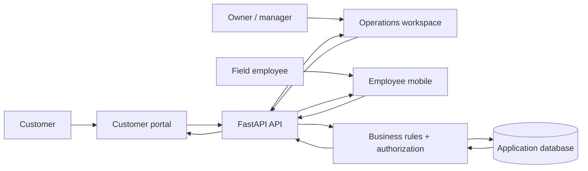

# CleanFlow — Product Walkthrough

CleanFlow is a full-stack commercial cleaning operations platform for running the customer journey and the operations journey in one connected product.

A customer can discover services, request a quote, review quotes, manage contracts, see upcoming service, review invoices and follow their service history. The operations team can manage leads, customers, pricing, quotes, contracts, schedules, jobs, employees, invoices, feedback, analytics, audit history and settings. Field employees get a focused mobile experience for the work assigned to them.

This walkthrough is written for someone who is simply looking at the product and wants to understand what it does.

## The product at a glance

**Customer request → lead → quote → contract → recurring schedule → job → field execution → invoice → payment → customer history**

The product is connected end to end:

**User action → React/Vite interface → FastAPI API → business rules + authorization → database → API response → updated interface**

The screenshots below are captured from the real CleanFlow application with live application data rather than mock screens.

## How the product works

## Public customer experience

### Home

CleanFlow starts with a public-facing website that explains the cleaning services, communicates the value of the business and gives customers a clear path into the service request flow.

### Request a quote

The quote request experience turns a visitor into a real business opportunity. The customer provides the information the cleaning team needs to understand the property and the requested service.

## Owner and operations workspace

### Sign in and choose a role

CleanFlow has separate experiences for the people who operate the business, the people who perform the work and the customers who receive the service.

### Dashboard

The dashboard is the operational overview of the business. Revenue, active contracts, upcoming jobs, completed work, outstanding invoices, new leads and conversion performance are visible together, while attention items surface work that needs follow-up.

### Leads

The lead workspace gives the team a place to organize incoming opportunities and move prospects toward becoming customers.

### Quotes

Quotes turn a customer's service requirements into a structured commercial proposal. Pricing, services and customer information stay connected to the rest of the workflow.

### Contracts

Contracts carry the relationship beyond the initial sale. They connect customer agreements to recurring service, scheduling and the operational work that follows.

### Calendar

The calendar gives the operations team a visual view of scheduled work so recurring service and upcoming jobs can be managed from one place.

### Jobs

Jobs are the operational unit of the service. They connect a customer, a property, a schedule and the employee work that has to happen in the field.

### Customers

Customer records keep the relationship and service history together so the operations team can quickly understand who the customer is, what services they receive and what work is associated with them.

### Employees

Employee management gives the business a central place to organize its workforce and connect people to the operational work they are responsible for.

### Invoices

Invoices turn completed service into a customer-facing financial record. Billing stays connected to the operational data that produced it.

### Analytics

Analytics brings the operational picture together so the business can see performance trends instead of relying only on individual records.

## Customer and operations handoff

### A customer request enters the business workflow

The customer starts from the public experience and submits the information needed to request service.

### The operations team works the request

That customer intent becomes part of the operations workflow, where the team can follow up, qualify the opportunity, prepare a quote and move the customer into the service lifecycle.

The important product flow is:

**Customer screen → API → business workflow → operations screen**

The customer experience and the staff experience are two views over the same connected application.

## Customer portal

### Customer home

The customer portal gives customers a focused view of their relationship with the cleaning company without exposing the internal operations workspace.

Customers can use the portal to see what is happening with their service, their account and their documents.

### Customer quotes

Quotes can be reviewed from the customer side so the customer experience continues beyond the initial website request and into the commercial decision.

## Field operations

### Employee mobile experience

The field employee experience is designed around the work happening at the property. Employees can focus on the jobs assigned to them and the information needed to complete the service cleanly from a mobile-sized interface.

This is where the office workflow becomes physical service delivery.

## Billing, feedback and operational visibility

Once service is delivered, CleanFlow keeps the rest of the relationship connected:

**Job completed → customer feedback → invoice → payment → customer history**

The operations side also includes audit history, notifications, team accounts, settings and feature controls so the business can manage the system as it grows.

## A real persistence example

One of the clearest product behaviors is that a record created in one part of CleanFlow can be read again from another part of the application.

A customer request can enter through the public experience, become a lead for the operations team, move into quoting and contract management, create scheduled work, produce jobs for employees and eventually appear in billing and the customer's history.

The same principle is used throughout the product:

**Create or change something in the interface → the backend processes it → the application stores it → another screen reads the updated record back**

## Feature map

| Area | What it is for |
|---|---|
| Public website | Customer discovery and service information |
| Quote requests | Turn customer interest into business opportunities |
| Leads | Track and progress new opportunities |
| Customers | Central customer relationship records |
| Properties | Keep service locations organized |
| Services & pricing | Reusable service definitions and pricing |
| Quotes | Customer-facing commercial proposals |
| Contracts | Ongoing service agreements |
| Scheduling | Recurring and future service planning |
| Calendar | Visual schedule and job overview |
| Jobs | Operational service work |
| Employee mobile | Field execution experience |
| Checklists & proof | Capture completion details from the field |
| Invoices | Customer billing |
| Payments | Track money received |
| Feedback | Capture the customer's service experience |
| Analytics | Business and operational visibility |
| Audit log | Activity history |
| Notifications | Keep users informed of important activity |
| Team accounts | Role-based access for staff |
| Customer portal | Customer-facing service history and documents |
| Settings & feature controls | Configure and operate the platform |
